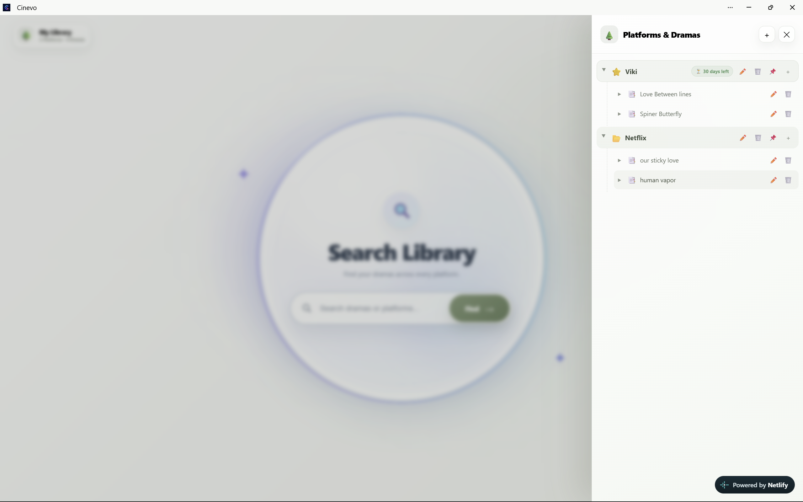
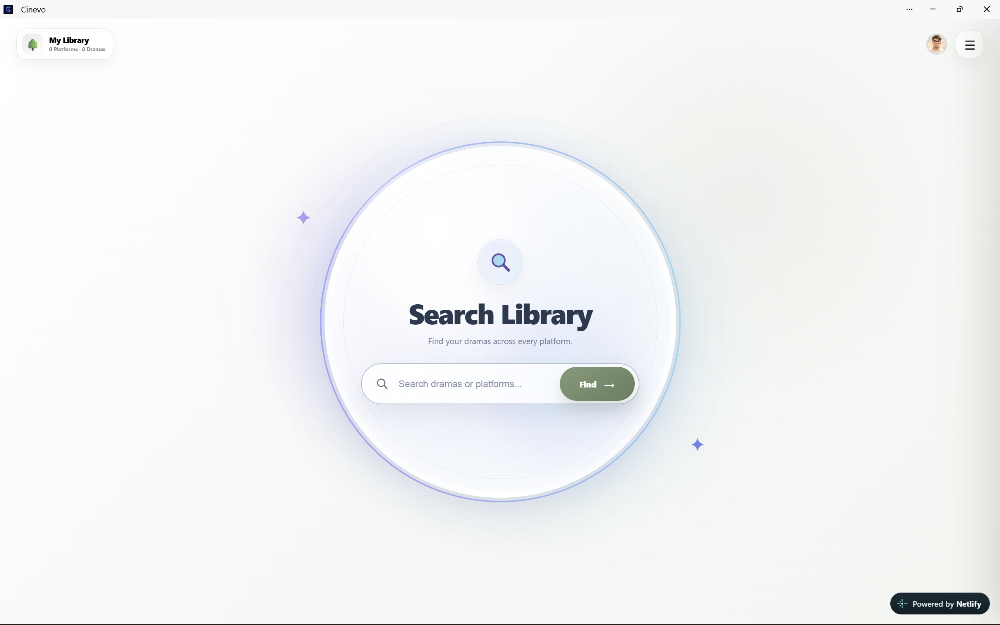

# Cinevo - Movie & Drama Tracker

A Progressive Web App (PWA) built to track, organize, and rate movie and drama watchlists across different streaming platforms with Google Cloud Sync.

## Features

- Organizes dramas by streaming platforms (Netflix, Prime, etc.).
- Allows the user to set a subscription countdown timer for 30-day binges.
- Enables and disables a "Watched" status for every show.
- Allows 5-star ratings for completed shows.
- Syncs data across devices using Google Cloud.

## Tech Stack Required

- HTML5
- CSS3
- Vanilla JavaScript
- Firebase Auth (Google Sign-In)
- Firebase Firestore (Realtime Database)

## How It Works

The app allows the user to create folders for different streaming services and add dramas directly underneath them. The user can navigate the sidebar menu to add platforms, adjust the subscription timer for a "Priority" platform, and toggle dramas as watched. When logged in via Google, the app reads and writes data to Firestore so the user's list is synced across all devices. The main search ring instantly checks if a specific drama has already been added.

## Project Photos

## Video Demonstration

## Limitations

- The user must have a Google account to utilize the cloud sync feature.
- Cross-device syncing requires an active internet connection (though it works offline locally via local storage).
- The priority timer requires manual input of remaining subscription days.

## Author

Ankur Deep Konch